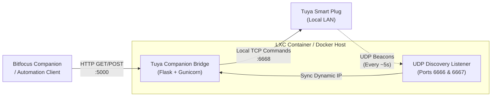

# Tuya Companion Bridge

[](https://python.org)
[](https://www.proxmox.com)
[](https://www.docker.com)
[](https://systemd.io)
[](LICENSE)

Local REST HTTP bridge to control Tuya Smart Plugs from Bitfocus Companion, Stream Deck, or HTTP automation clients with zero cloud latency and native dynamic IP auto-discovery.

---

## Architecture Overview



---

## Key Features

- **Local LAN Execution**: Direct TCP communication with devices — no Tuya Cloud roundtrips or internet dependency.
- **Dynamic IP Auto-Discovery**: Tuya devices continuously broadcast their status via UDP. The bridge listens on ports `6666` and `6667` in real time, automatically discovering and tracking dynamic DHCP IP changes without requiring static router reservations.
- **Self-Healing Connection**: If a device's IP shifts while the bridge is running, the bridge dynamically syncs the new address and transparently retries commands.
- **REST Endpoints for Stream Deck / Companion**: Clean JSON and plaintext endpoints (`/toggle`, `/on`, `/off`, `/status`, `/is_on`).
- **LXC & Container First**: Includes a native systemd unit, automated LXC installer, and integration with standard LXC `update` workflows.

---

## Repository Structure

```text
tuya-companion-bridge/
├── app.py                  # Core REST API service & UDP discovery engine
├── config.template.json    # Device template configuration
├── pyproject.toml          # PEP 621 package metadata & CLI entrypoint
├── requirements.txt        # Python dependencies
├── Dockerfile              # Hardened container image with HEALTHCHECK
├── docker-compose.yml      # Multi-port container orchestration (HTTP + UDP)
├── .dockerignore           # Build exclusion rules (secrets & caches)
├── install-lxc.sh          # One-command Proxmox / Debian LXC installer
├── update.sh               # Automated service updater (git pull + pip + restart)
├── tuya-bridge.service     # Systemd service unit definition
├── test_app.py             # Automated test suite (discovery + API endpoints)
├── start.sh                # Linux startup wrapper
├── start.bat               # Windows startup script
├── LICENSE                 # MIT License
└── README.md               # Documentation
```

---

## Setup & Configuration

1. Create `config.json` from the template:
   ```bash
   cp config.template.json config.json
   ```

2. Edit `config.json` with your device details:
   ```json
   {
     "port": 5000,
     "devices": [
       {
         "name": "desk-lamp",
         "id": "tuya_device_id_here",
         "ip": "auto",
         "key": "tuya_local_key_here",
         "version": "3.4"
       }
     ]
   }
   ```

### Dynamic IP Configuration (`ip` field):

- `"ip": "auto"` (or omit `"ip"`): The bridge automatically discovers the device IP address on the local network via Tuya UDP broadcasts. No router DHCP lease configuration required.
- `"ip": "192.168.1.50"`: Provide a known IP address as an initial hint. If the device's IP ever changes, the bridge automatically updates the IP in memory and re-establishes communication.

> Note: `config.json` contains local private keys and device IDs; it is ignored by git to prevent leaking secrets.

---

## Deployment Options

### Option A: Proxmox / Debian LXC (Recommended)

1. Clone or copy the repository inside your LXC container:
   ```bash
   git clone <REPO_URL> /opt/tuya-companion-bridge
   cd /opt/tuya-companion-bridge
   ```

2. Run the automated installer as root:
   ```bash
   sudo bash install-lxc.sh
   ```
   *The installer provisions dependencies, creates the Python venv, enables the systemd service, and links the bridge to the standard LXC `update` command.*

3. Edit `/opt/tuya-companion-bridge/config.json` with your Tuya credentials:
   ```bash
   nano /opt/tuya-companion-bridge/config.json
   systemctl restart tuya-bridge.service
   ```

#### Updating the LXC Service

Whenever you want to update the bridge to the latest code, simply run:

```bash
update
```

*(Or manually run `/opt/tuya-companion-bridge/update.sh`)*. This will:
1. Fetch and pull the latest code from git.
2. Upgrade Python dependencies if `requirements.txt` changed.
3. Gracefully reload and restart `tuya-bridge.service`.

---

### Option B: Docker Compose

1. Copy this folder to your server:
   ```bash
   cd tuya-companion-bridge
   docker compose up -d --build
   ```

2. Verify:
   ```bash
   curl http://<server-ip>:5000/health
   ```

> **Docker Networking Note:**
> Tuya auto-discovery listens for local network UDP broadcasts on ports `6666` and `6667`. These ports are mapped in `docker-compose.yml`. On Linux servers, setting `network_mode: host` in `docker-compose.yml` is recommended so the container has direct access to the local broadcast domain.

---

### Option C: Windows Native

Run directly with Python:

1. Create a virtual environment and install dependencies:
   ```cmd
   python -m venv venv
   venv\Scripts\pip install -r requirements.txt
   ```

2. Start the bridge:
   ```cmd
   venv\Scripts\python app.py
   ```

Or double-click `start.bat`.

---

## Testing

Run the automated test suite:

```bash
venv/Scripts/python test_app.py
```

The test suite validates:
- Background UDP discovery listener binding on ports 6666 and 6667.
- Automatic resolution of device IDs to dynamic IPs.
- Health endpoint (`/health`) and device list (`/devices`).
- Status and plaintext on/off state endpoints (`/status`, `/is_on`).
- Self-healing recovery when a device's IP address drifts or is unreachable.

---

## API Reference

### System Endpoints

| Method | URL | Description |
| :--- | :--- | :--- |
| GET | `/` or `/health` | Health check with resolved IP addresses and device status |
| GET | `/devices` | List all configured devices, current IPs, online state, and metrics |

### Default Device (First in config)

| Action | Method | URL | Description |
| :--- | :--- | :--- | :--- |
| Toggle | GET / POST | `http://<server-ip>:5000/toggle` | Switch state |
| Turn ON | GET / POST | `http://<server-ip>:5000/on` | Power on |
| Turn OFF | GET / POST | `http://<server-ip>:5000/off` | Power off |
| Status | GET | `http://<server-ip>:5000/status` | Current state and telemetry (JSON) |
| Is ON | GET | `http://<server-ip>:5000/is_on` | Plaintext `true` or `false` (ideal for Companion) |

### Named Device (by Name or Device ID)

| Action | Method | URL |
| :--- | :--- | :--- |
| Toggle | GET / POST | `http://<server-ip>:5000/<device-name>/toggle` |
| Turn ON | GET / POST | `http://<server-ip>:5000/<device-name>/on` |
| Turn OFF | GET / POST | `http://<server-ip>:5000/<device-name>/off` |
| Status | GET | `http://<server-ip>:5000/<device-name>/status` |
| Is ON | GET | `http://<server-ip>:5000/<device-name>/is_on` |

---

## Adding a New Device (Obtaining Device ID & Local Key)

Every Tuya device has its own unique 16-character `local_key`. To add another device to the bridge:

1. **Pair the Device**:
   - Add the device to your **Tuya Smart** or **Smart Life** mobile app as usual.

2. **Retrieve Credentials from Tuya Cloud Platform**:
   - Log in to [Tuya IoT Platform](https://platform.tuya.com/).
   - Navigate to **Cloud** ➔ **Development** ➔ **Project Management**.
   - Open your project and go to the **Project Overview / Basic Information** tab.
   - Copy your **Access ID / Client ID** and **Access Secret / Client Secret**.

3. **Run the TinyTuya Wizard**:
   - In your terminal / command prompt, run:
     ```bash
     python -m tinytuya wizard
     ```
   - Enter your **API Key** (Access ID) and **API Secret** (Access Secret) when prompted.
   - Select your data center region (e.g., `eu` for Europe, `us` for Americas).
   - TinyTuya will query your account and list all paired devices with their **Device ID** and **Local Key**.

4. **Update `config.json`**:
   - Add the new device entry under the `"devices"` array in `config.json` (IP can be `"auto"`):
     ```json
     {
       "name": "living-room-plug",
       "id": "<NEW_DEVICE_ID>",
       "ip": "auto",
       "key": "<NEW_16_CHAR_LOCAL_KEY>",
       "version": "3.4"
     }
     ```

5. **Restart the Bridge**:
   - **LXC / Systemd**: `sudo systemctl restart tuya-bridge`
   - **Docker**: `docker compose restart`
   - **Windows / Manual**: Restart the running Python process or `start.bat`.

---

## Bitfocus Companion Setup

### 1. Basic Control (Toggle / On / Off)

1. Open Companion web UI at `http://<companion-ip>:8000`.
2. Under **Connections**, add **Generic HTTP Requests**.
3. Under **Buttons**, select an empty button:
   - Set button text to `Toggle`.
   - Under **Press Actions**, add **generic-http: HTTP GET**.
   - Set URL:
     ```text
     http://$(custom:servicio_enchufes_ip):5000/pulpito/toggle
     ```
4. Press the button to test.

---

### 2. Live Button Feedback (Color on/off state)

To have the button automatically turn **Green when ON** and back to default when OFF:

1. **Create Custom Variable**:
   - Go to **Variables** ➔ **Custom Variables** tab in Companion.
   - Click **Add custom variable**:
     - Name: `pulpito_state`
     - Default value: `false`

2. **Create Periodic Polling Trigger**:
   - Go to **Triggers** tab ➔ **Add Trigger**.
   - **Name**: `Poll Pulpito State`
   - **Events**: Add **Time: Interval** ➔ set interval to `2000 ms`.
   - **Actions**: Add **generic-http: HTTP GET**:
     - **URL**: `http://$(custom:servicio_enchufes_ip):5000/pulpito/is_on`
     - **JSON Response Data Variable**: Select `custom:pulpito_state`
     - **Store result as text**: **Checked** (ON)
   - Enable the trigger (switch to **Active**).

3. **Add Button Feedback**:
   - Go to your button ➔ **Feedbacks** tab ➔ **Add feedback**.
   - Select **internal: Variable: Check boolean value** (or **Variable: Check value**).
   - **Variable**: `custom:pulpito_state`
   - **Condition**: `== true` (or equal to string `true`).
   - Style:
     - **Background Color**: Green (`#00ff00`)
     - **Text Color**: Black or White
